# LIBRARY COMPUTER ACCESS AND RETRIEVAL SYSTEM
## LCARS x32 — Operator Technical Manual

> **Public entry point:** See [`README.md`](README.md) for project summary, requirements, install/build, license, and upstream links. This document is the full in-universe operator manual.

---

```
████████████████████████████████████████████████████████████████
█  UNITED FEDERATION OF PLANETS — STARFLEET COMMAND           █
█  OFFICE OF COMPUTER SYSTEMS ENGINEERING                    █
█  DOCUMENT CLASS:  OPERATIONS / INTERFACE                   █
█  PACKAGE DESIGNATION:  LCARS x32                           █
█  MANUAL TYPE:  TECHNICAL / INSTRUCTION                     █
█  DISTRIBUTION:  AUTHORIZED PERSONNEL                       █
████████████████████████████████████████████████████████████████
```

> **NOTICE TO OPERATORS**  
> This manual describes the LCARS x32 desktop interface shell for Federation-compatible computational platforms. All controls, panels, and auxiliary programs herein are part of a unified Library Computer Access and Retrieval System presentation layer. Follow standard Starfleet console discipline: confirm critical actions, maintain situational awareness of alert status, and restore the interface to a known-good mode before leaving station.

---

## 0.0  DOCUMENT CONTROL

| Field | Value |
|------:|:------|
| **System Name** | LCARS x32 |
| **Function** | Primary workstation shell / command interface |
| **Audience** | Duty officers, systems operators, systems engineers |
| **Companion Media** | `/Screenshots` — reference plates for this revision |
| **Revision Intent** | Field-ready operator briefing with visual plates |

---

## 1.0  SYSTEM OVERVIEW

LCARS x32 presents a full-station command surface on a terrestrial Windows computational platform. The shell replaces conventional desktop chrome with Starfleet-standard LCARS geometry: elbows, status rails, mode selectors, and a central working area for applications.

### 1.1  Primary Capabilities

| Subsystem | Function |
|-----------|----------|
| **Interface Modes** | Multiple main-screen layouts for duty preference and station geometry |
| **Environmental Telemetry** | Continuous weather / locality readout on the command rail |
| **Start Menu & Search** | Program directory, directory navigation, and query launch |
| **Quick / Personal Programs** | Rapid access panel for volume, power, network, and pinned tools |
| **On-Screen Keyboard (OSK)** | Touch-capable input overlay with move / resize / elevate controls |
| **Settings** | Appearance, weather locality, clock modes, voice, alerts, updates |
| **Engineering** | Live diagnostics — processors, memory composition, disks, power, network, event log |
| **Communications (Comms)** | Mail, chat, RSS, and calendar under a unified communications suite |
| **Auxiliary Utilities** | Weather panel, scientific calculator, timer / stopwatch, capture tools |
| **Web Browser** | Subspace-equivalent information retrieval with LCARS chrome |

### 1.2  Station Reference — Mode 01 (Primary Duty Layout)

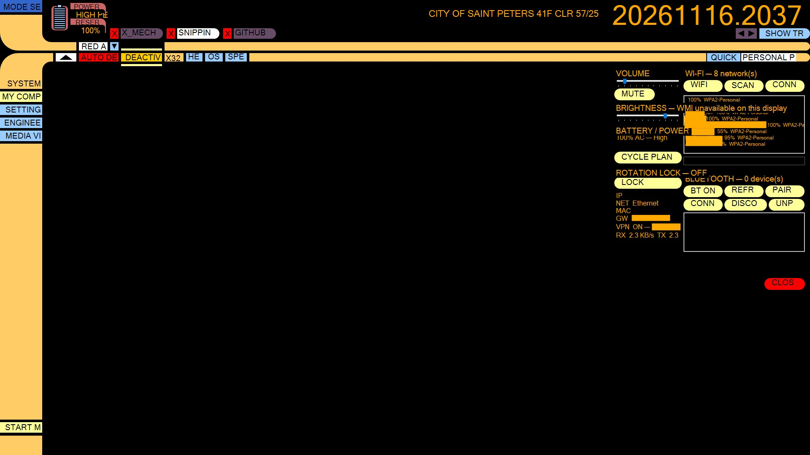

**Figure 1.2** — Mode 01 command surface. Left rail: SYSTEM / MY COMP / SETTING / ENGINEERING / MEDIA. Right panel: PERSONAL PROGRAMS (audio, power plan, rotation lock, Wi-Fi, Bluetooth, network telemetry). Center: application working area. Header: power reserve, environmental string, and chronometer.

---

## 2.0  INTERFACE MODES

Operators may select among authorized main-screen configurations. Modes alter framing, rail placement, and chronometer presentation while preserving access to Start, Settings, Engineering, and auxiliary programs.

### 2.1  Mode 02 — Horizontal Command Rail

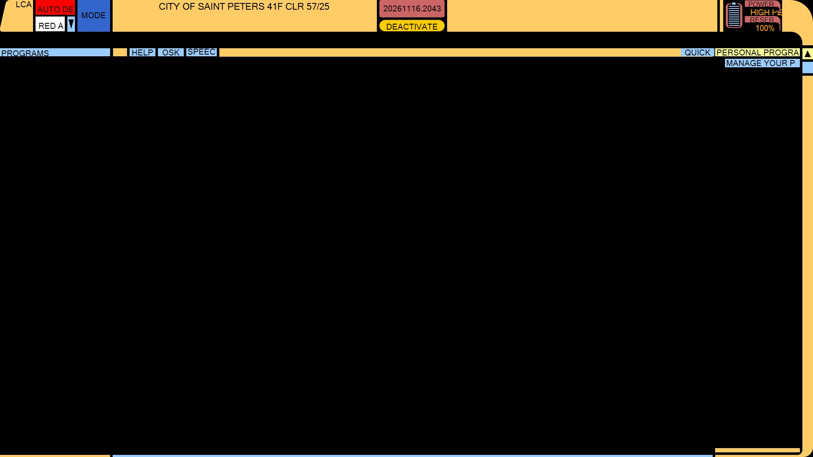

**Figure 2.1** — Mode 02. Upper elbow with MODE / RED ALERT / DEACTIVATE controls; PROGRAMS, HELP, OSK, SPEECH, and QUICK / PERSONAL PROGRAMS along the secondary rail; environmental telemetry embedded in the primary bar.

### 2.2  Mode 03 — Dual-Edge Task Layout

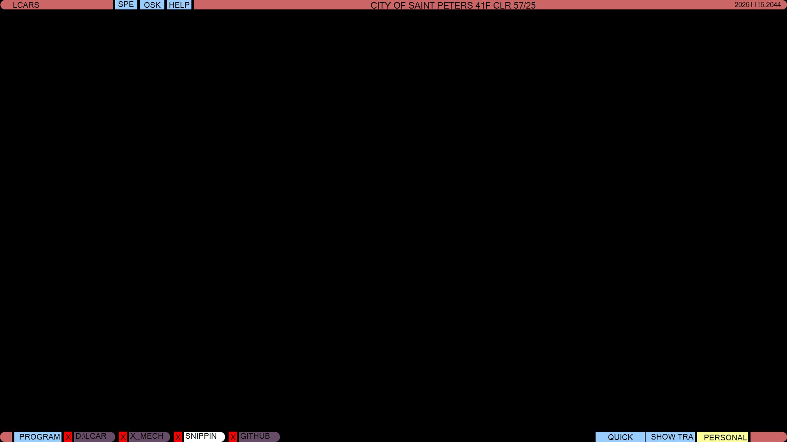

**Figure 2.2** — Mode 03. Upper LCARS bar with SPEECH / OSK / HELP; lower task strip for running applications (PROGRAM, QUICK, SHOW TRAY, PERSONAL). Environmental readout remains on the upper status continuum.

### 2.3  Mode 04 — Resource & Media Command Layout

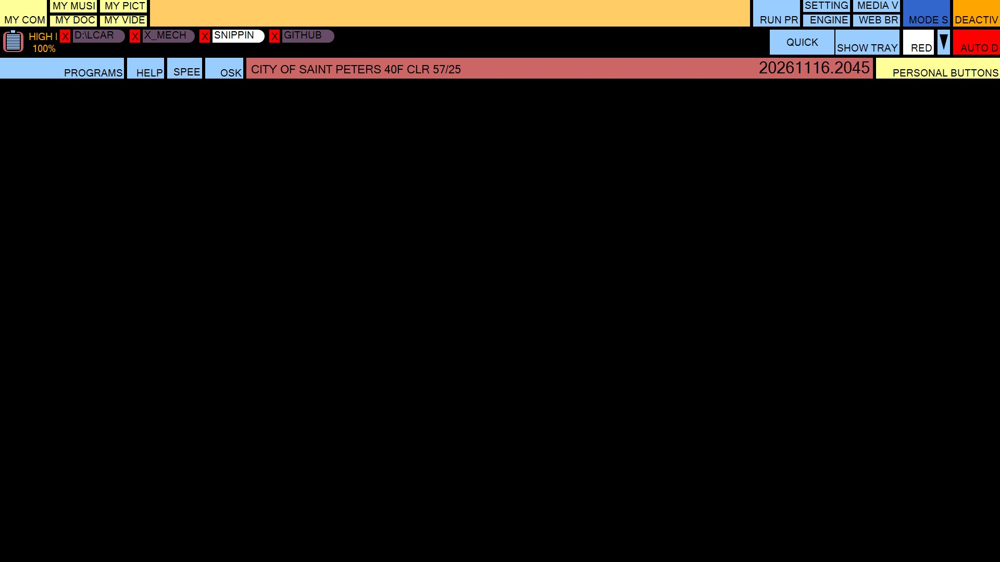

**Figure 2.3** — Mode 04. Upper media shortcuts (MY COMPUTER / MUSIC / PICTURES / DOCUMENTS / VIDEO) with SETTING, MEDIA VIEWER, RUN PROGRAM, ENGINEERING, WEB BROWSER, and MODE SELECT. Secondary rail: PROGRAMS / HELP / SPEECH / OSK, environmental string, and chronometer.

> **OPERATOR NOTE — MODE SELECT**  
> Use **MODE SELECT** (or equivalent mode control on the active layout) to open the Interface Selector. Confirm **SELECT** only after verifying the desired thumbnail. **CANCEL** aborts without change.

---

## 3.0  ENVIRONMENTAL TELEMETRY

### 3.1  Command-Rail Weather String

Continuous locality and meteorological summary is displayed on the active mode’s status rail.


**Figure 3.1** — Canonical weather HUD string format:  
`LOCALITY  ·  TEMPERATURE  ·  CONDITION CODE  ·  HIGH/LOW`

Example interpretation: locality name, current temperature, sky condition abbreviation (e.g. CLR = clear), and forecast high/low for the duty period.

### 3.2  Configuration

Weather locality is configured under **SETTINGS → APPEARANCE** (see Section 6.0). Blank locality instructs the system to attempt automatic resolution. No external API credential is required for standard meteorological acquisition.

---

## 4.0  START MENU AND PROGRAM DIRECTORY

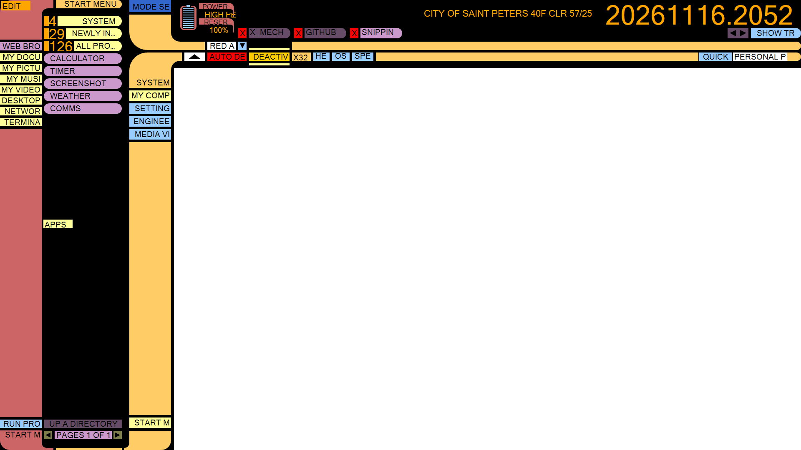

**Figure 4.0** — Start Menu open. Operators may browse SYSTEM / ALL PROGRAMS, launch **CALCULATOR**, **TIMER**, **SCREENSHOT**, **WEATHER**, and **COMMS**, navigate MY DOCUMENTS / PICTURES / MUSIC / VIDEO / DESKTOP / NETWORK / TERMINAL, or use RUN PROGRAM. Pagination and UP A DIRECTORY support deep directory trees.

### 4.1  Standard Launch Procedure

1. Press **START M** (or the mode-equivalent Start control).  
2. Locate the desired program entry.  
3. Activate the entry once. The Start panel may retract; the program opens in the working area or as a floating LCARS panel.  
4. Use the program’s **CLOSE** control to terminate the session cleanly.

### 4.2  Search

When Search is available on the active layout, enter a query to retrieve matching programs, local files, and approved information links. Select a result to launch or open.

---

## 5.0  ON-SCREEN KEYBOARD (OSK)

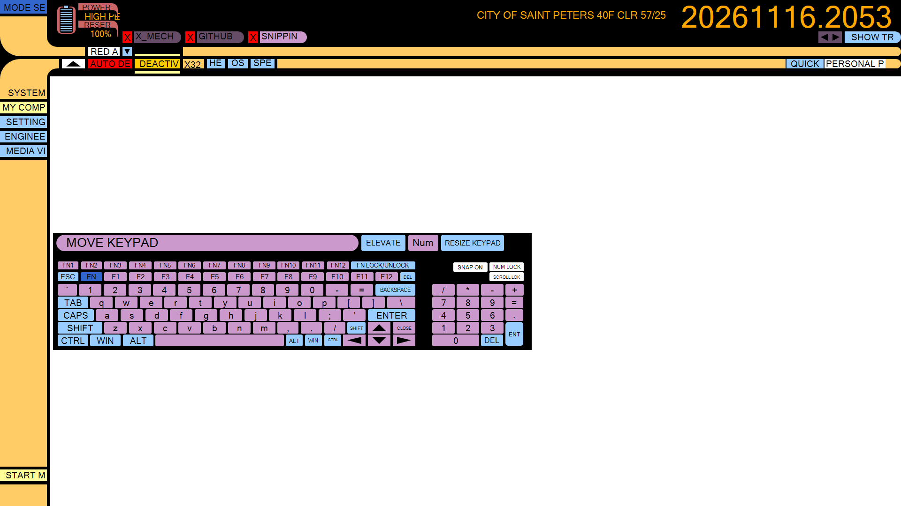

**Figure 5.0** — OSK deployed. Controls include **MOVE KEYPAD**, **ELEVATE**, numeric mode, **RESIZE KEYPAD**, full alphanumeric matrix, function row, and optional numpad with **SNAP ON** / **NUM LOCK**.

### 5.1  OSK Operating Notes

| Control | Purpose |
|---------|---------|
| **MOVE KEYPAD** | Drag the keyboard assembly to a clear region of the working area |
| **RESIZE KEYPAD** | Adjust footprint for tablet or desktop duty stations |
| **ELEVATE** | Raise input priority when another panel intercepts keystrokes |
| **Num / Numpad** | Enable numeric entry cluster |

Dismiss via the OSK close path or the shell control that spawned it. Do not leave OSK elevated over critical alert controls during Red Alert drills.

---

## 6.0  SETTINGS — STATION PERSONALIZATION

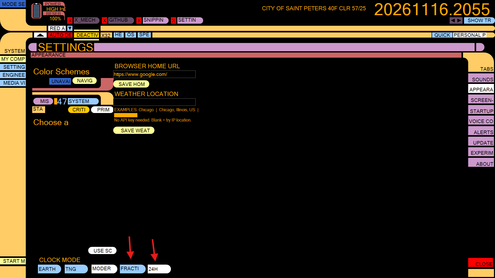

**Figure 6.0** — SETTINGS / APPEARANCE. Configure browser home URL, weather locality, color scheme samples, and chronometer modes (including Earth / TNG presentation and 24-hour options). Right rail selects SOUNDS, APPEARANCE, SCREEN, STARTUP, VOICE COMMANDS, ALERTS, UPDATE, EXPERIMENTAL, and ABOUT.

### 6.1  Critical Settings Actions

| Action | Procedure |
|--------|-----------|
| **Save browser home** | Enter URL → **SAVE HOME** |
| **Save weather locality** | Enter city / region string → **SAVE WEATHER** |
| **Chronometer mode** | Select EARTH / TNG / related presentation toggles; apply before ending watch |
| **Updates** | Use UPDATE section to acquire authorized package revisions |
| **Voice / Alerts** | Configure speech and alert behavior only after confirming audio hardware |

> **CAUTION**  
> Experimental options may alter console stability. Enable only under systems-engineer supervision.

---

## 7.0  INFORMATION RETRIEVAL — WEB BROWSER

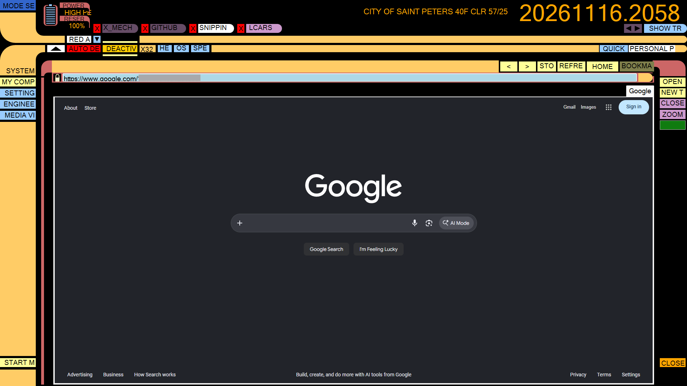

**Figure 7.0** — Web Browser with LCARS chrome: navigation (`<` `>`), store, refresh, home, bookmarks; OPEN / NEW TAB / CLOSE / ZOOM on the right rail; address field for subspace-equivalent URLs.

### 7.1  Browser Protocol

1. Launch via **WEB BROWSER** control or Start Menu.  
2. Enter destination in the address field or use **HOME**.  
3. Use **NEW TAB** for parallel retrieval; **CLOSE** ends the active tab or session per panel design.  
4. Bookmark frequently used Federation / research endpoints via **BOOKMARKS**.

---

## 8.0  ENGINEERING — DIAGNOSTIC CONSOLE

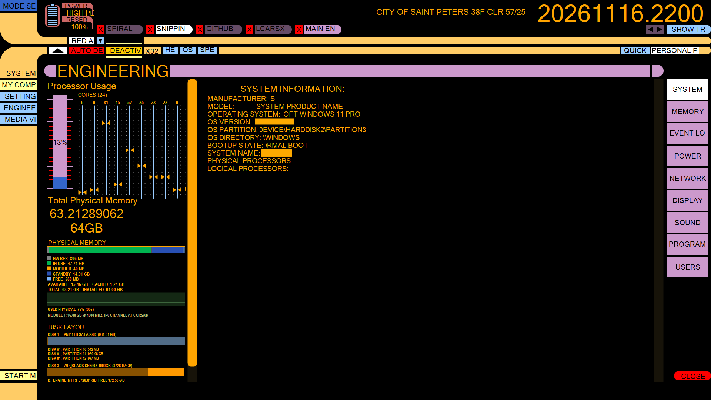

**Figure 8.0** — ENGINEERING console. Left: processor core utilization, physical memory composition, disk layout. Center: system identity and boot state. Right rail: SYSTEM / MEMORY / EVENT LOG / POWER / NETWORK / DISPLAY / SOUND / PROGRAMS / USERS.

### 8.1  Engineering Sections

| Section | Contents |
|---------|----------|
| **SYSTEM** | Manufacturer, OS, partition, boot state, processor counts |
| **MEMORY** | Detailed memory accounting and composition |
| **EVENT LOG** | Application / System / Security event review |
| **POWER** | Power plans and power-related controls |
| **NETWORK** | Adapter inventory and configuration aids |
| **DISPLAY / SOUND** | Display and audio station controls |
| **PROGRAMS / USERS** | Installed programs and local account overview |

### 8.2  Engineering Discipline

- Prefer **REFRESH**-class actions before declaring hardware fault.  
- Clearing event logs is a privileged action — confirm before execution.  
- Network enable/disable and static addressing changes can interrupt subspace (network) links; coordinate with the watch officer.

---

## 9.0  AUXILIARY UTILITIES

Floating utility panels provide focused tools without abandoning the main interface mode.

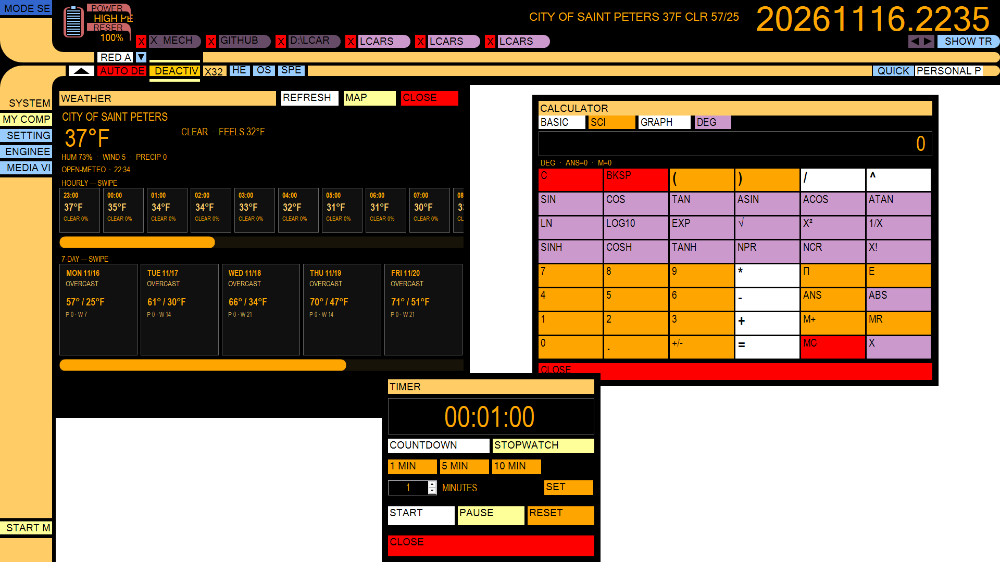

**Figure 9.0** — Concurrent auxiliary panels: **WEATHER** (conditions, hourly and multi-day forecast), **CALCULATOR** (BASIC / SCI / GRAPH), **TIMER** (countdown / stopwatch with presets).

### 9.1  Weather Utility

| Control | Function |
|---------|----------|
| **REFRESH** | Re-acquire meteorological data |
| **MAP** | Open geographic context (when available) |
| **CLOSE** | End weather panel session |

### 9.2  Calculator

| Mode | Function |
|------|----------|
| **BASIC** | Arithmetic keypad |
| **SCI** | Scientific functions (trig, log, exp, etc.) |
| **GRAPH** | Function plotting / analysis aids |
| **DEG / RAD** | Angular mode for scientific operations |

### 9.3  Timer

| Control | Function |
|---------|----------|
| **COUNTDOWN / STOPWATCH** | Select timing regime |
| **1 / 5 / 10 MIN** | Rapid presets |
| **SET** | Apply custom minute value |
| **START / PAUSE / RESET** | Run control |

### 9.4  Screenshot

Launch **SCREENSHOT** from Start Menu to capture the station display. Follow on-panel prompts for capture, preview, and folder access. Store captures in the designated LCARS capture directory on the local system.

---

## 10.0  COMMUNICATIONS SUITE (COMMS)

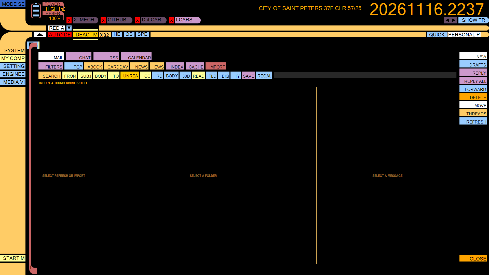

**Figure 10.0** — COMMS / MAIL. Tabs: MAIL / CHAT / RSS / CALENDAR. Tool rails for filters, PGP, address book, CardDAV, news, EWS, index, cache, and import. Message workflow: NEW / DRAFTS / REPLY / REPLY ALL / FORWARD / DELETE / MOVE / THREADS / REFRESH.

### 10.1  Mail Console Procedure

1. Launch **COMMS** from Start Menu.  
2. Select **MAIL**.  
3. **REFRESH** or **IMPORT** to populate folders (including authorized profile import paths when prompted).  
4. Select folder → select message → use REPLY / FORWARD / DELETE as required.  
5. **CLOSE** returns to the main interface.

### 10.2  Additional Comms Modules

| Module | Purpose |
|--------|---------|
| **CHAT** | Real-time text communications |
| **RSS** | Syndicated information feeds |
| **CALENDAR** | Scheduling and event coordination |

> **SECURITY**  
> Protect authentication material. Do not record access codes in screenshots or shared manuals. Use PGP and directory features only under local security policy.

---

## 11.0  INSTALLATION AND REPLICATION PROCEDURES

### 11.1  Authorized Platform

| Requirement | Specification |
|-------------|---------------|
| **Host OS** | Windows (Federation-compatible terrestrial platform) |
| **Architecture** | x86 / compatible workstation or tablet |
| **Role** | LCARS may operate as a standard application shell or as an elevated workstation shell per local configuration |

### 11.2  Field Deployment (Prebuilt Package)

1. Acquire the authorized LCARS x32 package revision from your update channel or distribution archive.  
2. Place package contents in the designated installation directory.  
3. Execute **LCARSmain.exe**.  
4. On first activation, configure **SETTINGS → APPEARANCE** (weather locality, chronometer) and verify **START M** launches utilities.  
5. Confirm Engineering and Comms open without error before declaring the station ready.

### 11.3  Systems Engineering — Source Replication

For engineers reconstituting the package from source control:

1. Obtain the repository on a Windows development station.  
2. Ensure .NET Framework 4.x build tools (MSBuild) and required SDK utilities are present.  
3. Execute the project build script (`tools/Build-LCARS.ps1`) with the authorized configuration.  
4. Package with `tools/Package-LCARSUpdate.ps1` when preparing a numbered field revision.  
5. Validate against this manual’s visual plates: Modes 01–04, OSK, Settings, Browser, Engineering, utilities, and Comms.

### 11.4  Update Discipline

Use the in-console **UPDATE** pathway when available. After update:

- Verify version identity in About / update status.  
- Re-test Start Menu launches for CALCULATOR, TIMER, SCREENSHOT, WEATHER, and COMMS.  
- Confirm Engineering right-rail sections respond.  
- Spot-check weather HUD string on the active mode.

---

## 12.0  ALERTS AND EMERGENCY CONTROLS

| Control | Meaning |
|---------|---------|
| **RED ALERT** | Heightened alert presentation; treat as priority visual state |
| **AUTO DESTRUCT** (where present) | Destructive sequence control — **do not activate** outside authorized drill protocol |
| **DEACTIVATE** | Ends LCARS session / returns platform per local shell policy |

> **STANDING ORDER**  
> Auto-destruct and related critical sequences are for controlled drills only. Unauthorized activation is a violation of Starfleet computer-use protocol.

---

## 13.0  TROUBLESHOOTING QUICK REFERENCE

| Symptom | Immediate Action |
|---------|------------------|
| Utility does not appear | Confirm executable presence beside `LCARSmain.exe`; relaunch from Start Menu |
| Weather string shows placeholder | Set locality in SETTINGS → APPEARANCE → SAVE WEATHER; check network |
| OSK not visible | Toggle OSK from the mode rail; use MOVE KEYPAD if off-screen |
| Engineering panels empty | Select right-rail section; allow refresh; verify WMI / permissions on host |
| Comms empty folders | REFRESH or IMPORT; verify credentials and network |
| Browser blank | Confirm WebView2 runtime on host; retry HOME URL from Settings |

---

## 14.0  ACKNOWLEDGEMENTS

This interface exists because of the craft of Federation interface design heritage and the labor of civilian and Starfleet-aligned software artisans who maintained LCARS x32 through successive computational generations.

Special recognition is extended to the originating LCARS x32 engineering community, to the visual language established for Starfleet Library Computer systems, and to all operators who filed precise after-action notes that improved this station.

---

## 15.0  END OF MANUAL

```
████████████████████████████████████████████████████████████████
█  END TRANSMISSION                                            █
█  LCARS x32 — OPERATOR TECHNICAL MANUAL                       █
█  MAINTAIN CONSOLE READINESS  ·  VERIFY BEFORE RELIEF         █
████████████████████████████████████████████████████████████████
```

*Starfleet Computer Systems Engineering — for authorized distribution with package LCARS x32.*
