# LCARS x32

**Windows desktop shell** that replaces ordinary desktop chrome with a full LCARS command interface — modes, Start Menu, Engineering, Comms, browser, OSK, weather, and auxiliary utilities.

Fork of the community [LCARS x32](https://github.com/LCARSx32/Main-LCARS-x32-Project) project, continued here as an independent line of work.

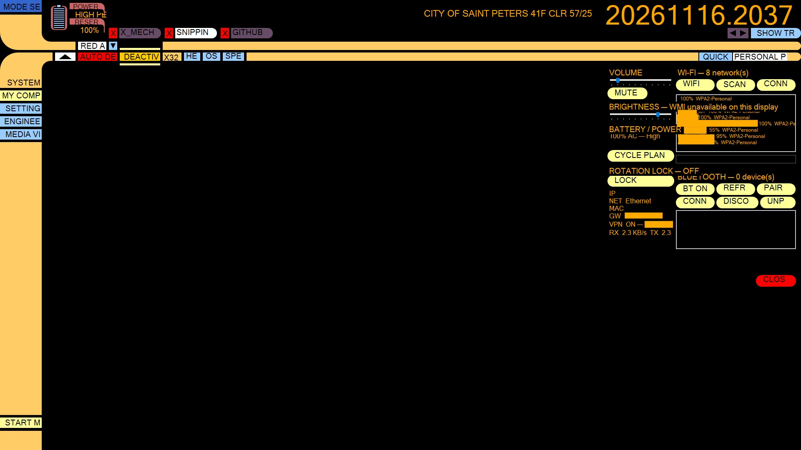

---

## Features

| Area | What you get |
|------|----------------|
| **Interface modes** | Multiple main-screen layouts (see gallery below) |
| **Start Menu / Search** | Program directory, folders, Calculator / Timer / Screenshot / Weather / Comms |
| **Quick / Personal Programs** | Volume, power, Wi‑Fi, Bluetooth, network readout |
| **Engineering** | CPU cores, memory composition, disks, event log, power / network / display / sound |
| **Comms** | Mail, chat, RSS, calendar |
| **Browser** | LCARS-skinned WebView2 browser |
| **OSK** | On-screen keyboard (move / resize / elevate) |
| **Weather** | Status-rail HUD + dedicated weather panel |
| **Settings** | Appearance, locality, clock modes, voice, alerts, updates |

Full operator walkthrough (in-universe Starfleet manual style): **[OPERATOR-MANUAL.md](OPERATOR-MANUAL.md)**

---

## Gallery

| Mode 01 | Mode 02 |
|:--:|:--:|
|  | 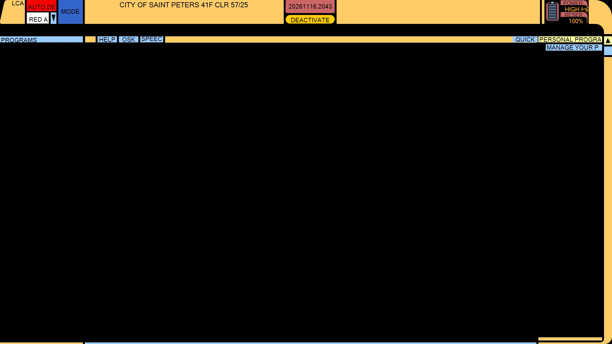 |
| **Mode 03** | **Mode 04** |
| 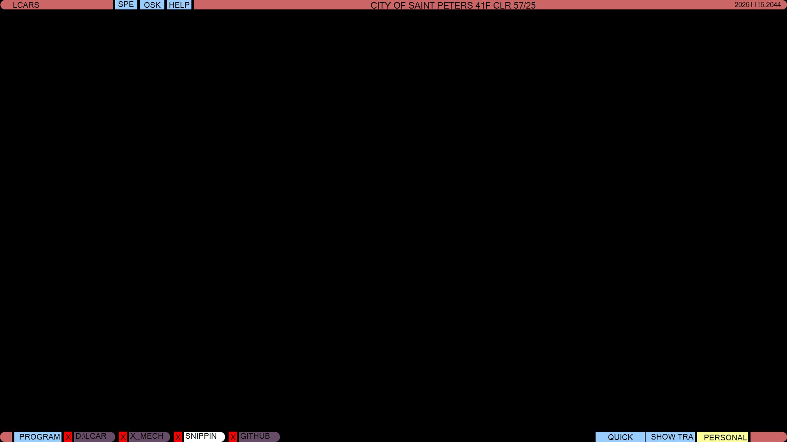 | 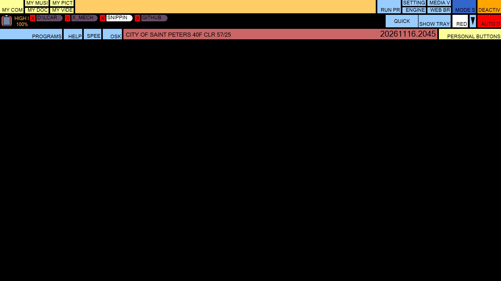 |

| Engineering | Comms | Utilities |
|:--:|:--:|:--:|
| 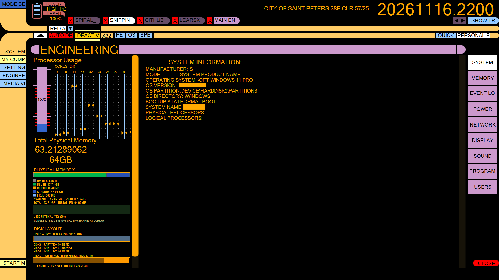 | 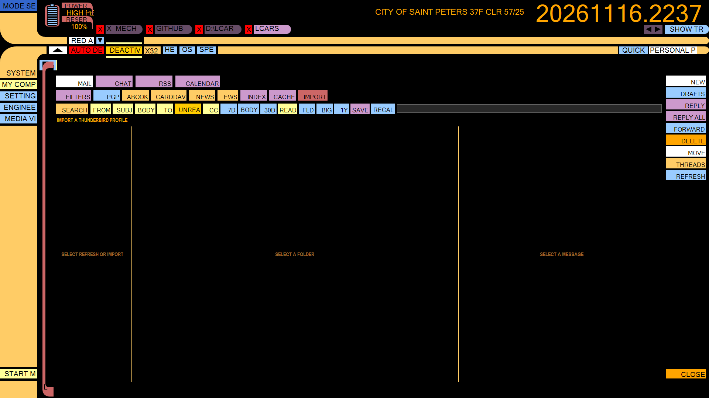 | 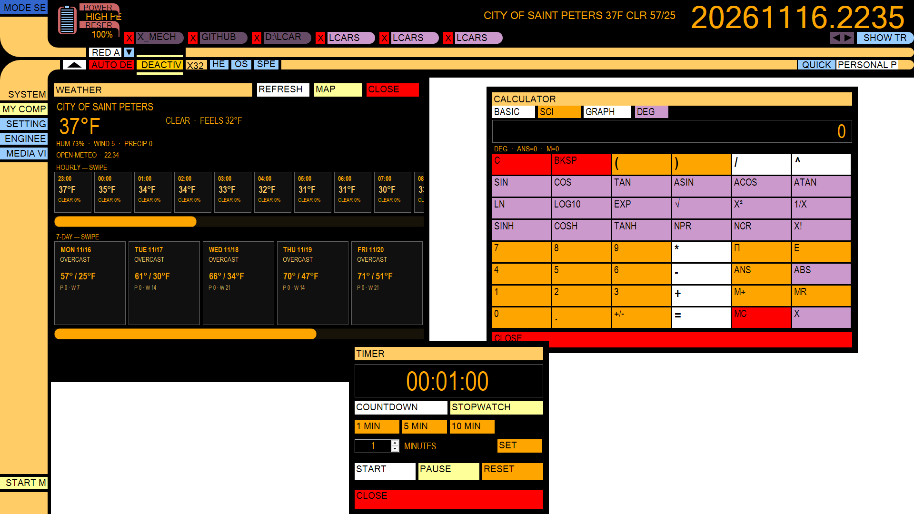 |

| Browser | Settings | OSK | Start |
|:--:|:--:|:--:|:--:|
| 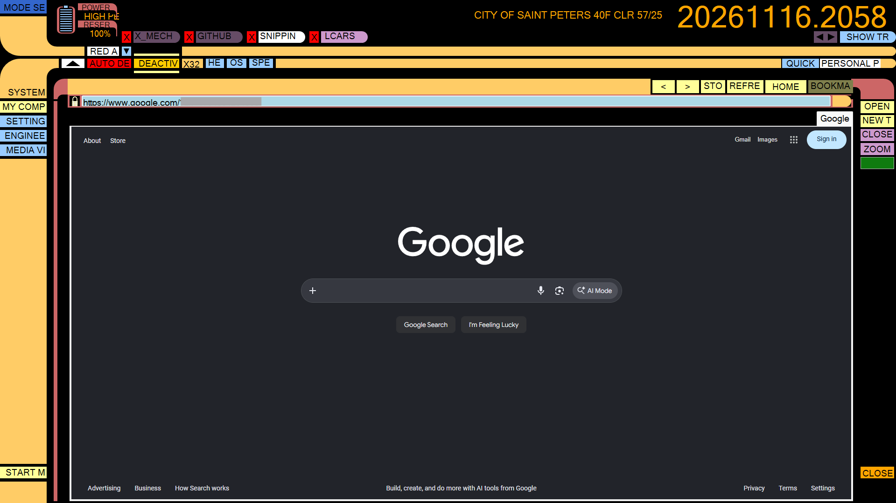 | 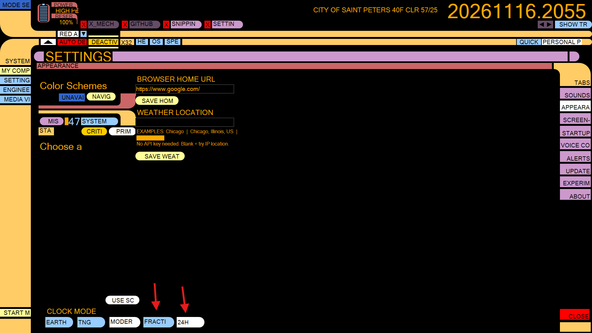 | 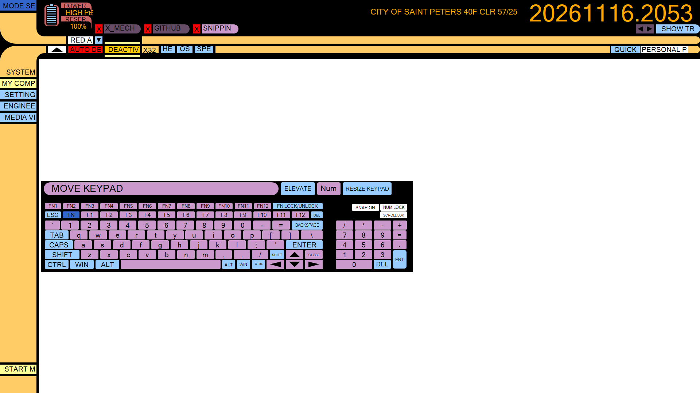 | 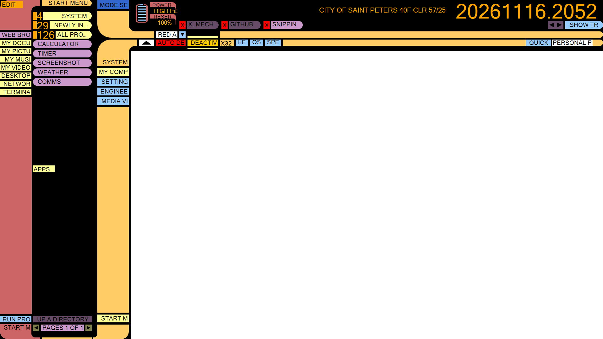 |

---

## Requirements

### Run (minimum)

| Item | Guidance |
|------|----------|
| **OS** | Windows 10 or later (**32-bit or 64-bit**). Not “x86-only”: 64-bit Windows is fine; some satellites are x86. |
| **CPU** | **4 cores** recommended (usable on fewer; Engineering/Comms/browser feel better with 4+) |
| **RAM** | **2 GB** minimum; **4 GB+** recommended if you use Comms + Browser together |
| **Disk** | ~200–500 MB for the app tree, plus [WebView2 Runtime](https://developer.microsoft.com/microsoft-edge/webview2/) if not already installed |
| **Display** | 1280×720 or higher; touch optional (helps with OSK / tablet use) |
| **Runtime** | .NET Framework **4.8** recommended for the full suite (main shell targets older 4.x; Mail/Comms expect 4.8) |
| **Browser** | **Microsoft Edge WebView2 Runtime** (required for the LCARS web browser) |
| **Speech** | Optional — Windows SAPI voices if you enable speech features |
| **Network** | Optional for weather / mail / updates; shell runs offline without them |

### Build (developers)

| Item | Guidance |
|------|----------|
| Windows PC with **MSBuild** (.NET Framework 4.x toolset) |
| **.NET Framework 4.8.1** SDK tools (`resgen`, etc.) as used by `tools/Build-LCARS.ps1` |
| **.NET SDK** (`dotnet`) — builds Comms (LCARSMail) and Utilities (C# projects) |
| Visual Studio 2019/2022 optional but convenient |

---

## Get the software

### Prebuilt package

1. Download a release zip from this repository’s **[Releases](../../releases)** page when published, **or** build from source (below).  
2. Extract so `LCARSmain.exe` sits with its companion binaries (`LCARS.dll`, utilities, Comms, etc.).  
3. Run `LCARSmain.exe`.  
4. Open **Settings → Appearance** to set weather locality and clock preferences; confirm Start Menu launches Calculator / Comms.

> There is **no public update server** for this fork. You may host your own LAN update endpoint if you want in-app updates (`tools/Package-LCARSUpdate.ps1` / `tools/Upload-LCARSUpdate.ps1` are for self-hosted setups). Do not commit private update URLs.

### Build from source

```powershell
cd Main-LCARS-x32-Project
powershell -File tools\Build-LCARS.ps1 -Configuration Debug
```

Output lands under `LCARSmain\LCARSmain\bin\Debug\` (and related satellite folders). To stage an update package locally:

```powershell
powershell -File tools\Package-LCARSUpdate.ps1 -Configuration Debug -Bump
```

See [CONTRIBUTING.md](CONTRIBUTING.md) for bug reports and PR expectations.

---

## Operator manual

For mode-by-mode procedures, Engineering sections, Comms workflow, and troubleshooting in Starfleet technical-manual voice:

**→ [OPERATOR-MANUAL.md](OPERATOR-MANUAL.md)**

---

## License

Dual-licensed under **Apache License 2.0** and **GNU GPL v3.0** (or later, at your option, under the terms in [`LICENSE.txt`](LICENSE.txt)). You must comply with at least one of those licenses.

---

## Out of universe — credits, trademarks, and upstream

This section is plain English for GitHub visitors and contributors.

**What this is.** A fan freeware Windows shell themed after Starfleet’s LCARS interface from *Star Trek*. It is **not** affiliated with, endorsed by, or connected to CBS, Paramount, or their licensees.

**Trademarks / design.** LCARS and related *Star Trek* elements are trademarks and copyrights of their respective owners (historically CBS / Paramount). Michael Okuda created the LCARS visual language. Fan projects such as this exist only because rights holders have historically tolerated non-commercial fan freeware — respect that boundary.

**Upstream / original project.** This repository is a **fork** of the community LCARS x32 codebase:

- Upstream: [https://github.com/LCARSx32/Main-LCARS-x32-Project](https://github.com/LCARSx32/Main-LCARS-x32-Project)

Original and community credit (from the project’s traditional acknowledgements) includes in particular:

- **Raymond Philips** — LCARS x32 community and [lcarsx32.com](http://www.lcarsx32.com)
- **Tim Hughes** — ongoing main application development
- **Alan Fidler** — peripheral applications
- **Amerigo** — add-on applications
- The wider **LCARS x32 community**

This fork continues development independently while remaining grateful to that foundation.

**Libraries.** Third-party components (e.g. DotNetZip, MailKit/MimeKit, WebView2, LibVLC where used) retain their own licenses; see tree and vendor notices.

---

## Repo settings (for maintainers)

On the GitHub repository **About** box (right-hand sidebar, gear icon), set:

- **Description:** e.g. `Windows LCARS desktop shell — modes, Engineering, Comms, browser, OSK (fork of LCARSx32)`
- **Website:** optional (your project page or upstream)
- **Topics:** `lcars`, `star-trek`, `winforms`, `vb-net`, `windows-shell`, `desktop`
- **Social preview:** upload `Screenshots/mode-1.png` (or a cropped hero) under *Settings → General → Social preview* so link unfurls show the UI

Those are GitHub UI settings, not files in the repo.
